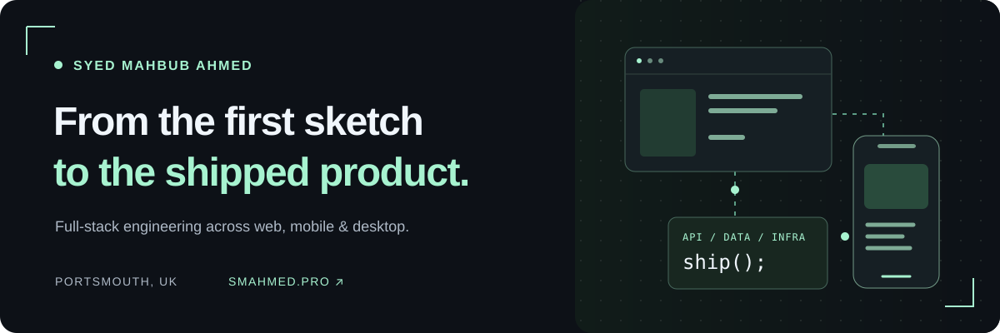
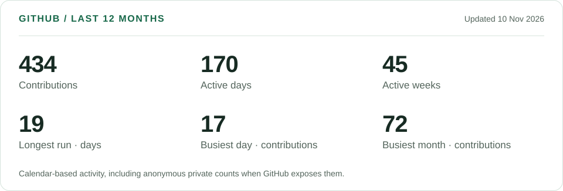
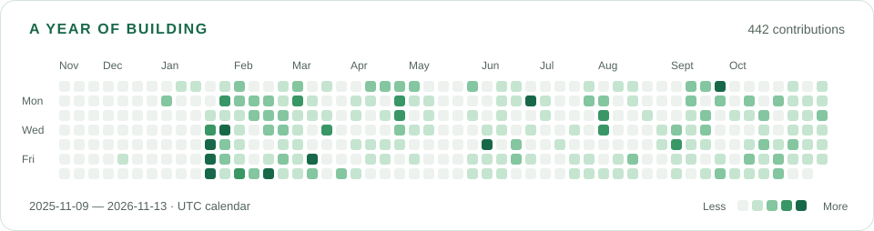

  

# Hi, I'm Syed Mahbub Ahmed.

**Full-stack engineer · Web, mobile & desktop · LEEDS, UK**

I build the parts people see and the systems that make them work: storefronts, native apps, APIs, real-time features and the infrastructure behind them. My favourite kind of work is taking a product from an early idea through to something a team can use every day.

  
  
  
  

---

## A few things I've shipped

### [An Nur](https://annurstore.co.uk) · A retail platform beyond the storefront

Built the platform from scratch: the online store, Express API, desktop point of sale and two staff mobile apps. The same system handles payments, fulfilment, partial cancellations, returns, refunds and credit notes.

| 5 applications | 6 shared packages | 126 data models | 267 test files |
| :---: | :---: | :---: | :---: |
| Web, desktop & mobile | A shared pnpm monorepo | PostgreSQL + Prisma | Vitest + CI gates |

Stripe, Redis, S3, marketplace feeds for eBay/Amazon/Temu, shipping rules and customs invoices sit behind the day-to-day retail workflows.

`TypeScript` `Next.js` `React Native` `Electron` `Express` `PostgreSQL` `Docker`

### [Daftar](https://daftar.smahmed.pro) · An iPhone app with its data at home

Designed, built and shipped a personal money and focus notebook to the App Store. Data stays on the device in SQLite, with versioned migrations, user-owned backups and a Face ID lock. Native widgets, Live Activities and Siri make it useful beyond the app itself.

`Expo` `React Native` `TypeScript` `SQLite` `Drizzle ORM` `Zustand`

### Newgrade AI · Collaboration with AI in the workflow

As CTO, built hands-on across an AI collaboration and task-management platform: mobile experiences, Node.js APIs, Socket.IO messaging and push notifications. Integrated Anthropic agents, tool calling, prompt caching and retrieval-augmented generation for contextual assistance.

`React Native` `Expo` `Express` `MySQL` `Prisma` `Socket.IO` `Anthropic`

### [Flojoy Studio](https://github.com/flojoy-io/studio) · Making desktop releases safer

Built the Electron app's CI/CD pipeline and Playwright end-to-end tests, and created a Terraform-defined AWS machine image for Flojoy Cloud. Worked across web products alongside the desktop and Python stack.

`Electron` `React` `Python` `Playwright` `Terraform` `AWS`

<strong>One more: Bebaha, a matrimonial platform</strong>

Built registration, preference-based partner search, real-time chat, paid premium access and an access-controlled admin dashboard.

**Stack:** Next.js, TypeScript, NestJS, Socket.IO, MongoDB and SSLCommerz. [Visit Bebaha →](https://bebaha.com)

## My engineering toolkit

| Layer | Technologies I work with |
| :--- | :--- |
| **Interfaces** | React, Next.js, TypeScript, Tailwind CSS, React Native / Expo, Electron |
| **Services** | Node.js, Express, NestJS, Python, FastAPI, Django REST Framework |
| **Data** | PostgreSQL, MySQL, MongoDB, Redis, SQLite, Prisma, Drizzle ORM |
| **Real-time & AI** | WebSockets, Socket.IO, WebRTC, Anthropic, tool calling, RAG |
| **Shipping & quality** | AWS, Terraform, Docker, GitHub Actions, Vitest, Playwright, Cypress |

I care about clear domain logic, useful tests, dependable releases and interfaces that make complicated work feel straightforward.

## The path here

| When | Where | Role |
| :--- | :--- | :--- |
| Sep 2026 – present | **An Nur Ltd** | UI/UX Manager |
| Jun 2025 – Sep 2026 | **An Nur Ltd** | Website Manager · part-time |
| Dec 2024 – Sep 2025 | **Newgrade AI** | Chief Technology Officer |
| Apr 2023 – Mar 2024 | **Flojoy** | Full Stack Web Developer |
| Jun 2022 – Mar 2023 | **NestGo** | Full Stack Web Developer |

I also hold an **MA in International Marketing from the University of Portsmouth**. It shapes how I think about a product's users, positioning and the work worth building.

## Behind the commits

Most of my commercial work lives in private repositories. The projects above give that work some context; this is a snapshot of my GitHub activity over the last year.

<picture>
  <source media="(prefers-color-scheme: dark)" srcset="./assets/github-stats-dark.svg" />
  
</picture>

<picture>
  <source media="(prefers-color-scheme: dark)" srcset="./assets/activity-dark.svg" />
  
</picture>

Generated from GitHub's API. Counts reflect GitHub's contribution rules and the generating token's visibility. Activity is a record of participation, rather than a measure of engineering ability. Shared private activity can appear anonymously; repository names and code are never included in these cards.

---

### Let's build something useful.

Interested in the architecture, decisions or tradeoffs behind one of these products? Let's talk.

**[Explore my portfolio →](https://smahmed.pro)** · **[Connect on LinkedIn](https://www.linkedin.com/in/syed-mahbub-ahmed-6bab84118/)** · **[Email me](mailto:contact@smahmed.pro)**
